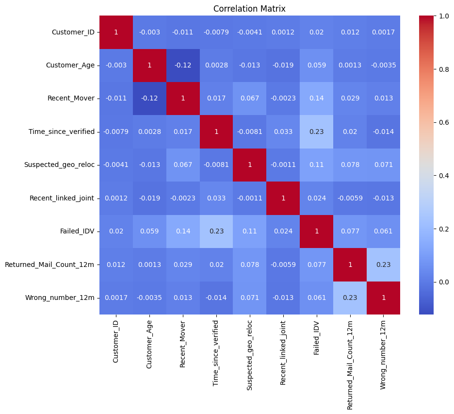
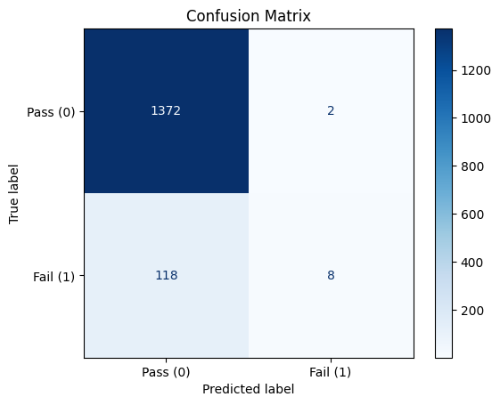
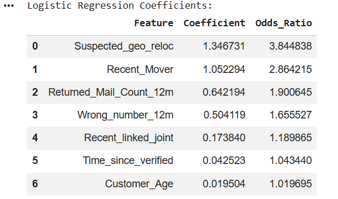
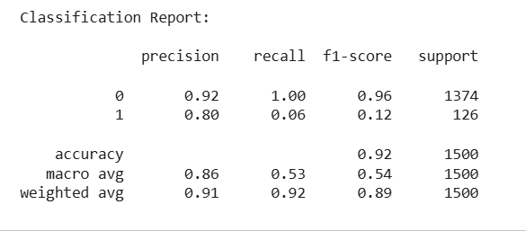

# Early Identification of Incorrect Customer Records Using Machine Learning 

**Author** Djahane Kleber Nzouatchep

## Project Overview

This project investigates whether machine learning techniques can assist financial institutions in identifying customers whose records may be inaccurate or out of date

# Key Finding
Indicators of customer relocation and contact-detail accuracy demonstrated the strongest associations with failed identity verification outcomes.

Banks seeking to improve customer record accuracy may benefit from focusing on customers whose circumstances indicate potential address or contact information changes.

# Project Visualisations

# Executive Summary
Accurate customer information is essential for effective banking operations, regulatory compliance and customer engagement. However, customer records can become outdated over time as individuals change address, telephone number or other personal details. Inaccurate records may contribute to operational inefficiencies, failed identification and verification checks, poor customer experiences and increased compliance risks. This study investigates whether machine learning techniques can assist in the early identification of customers whose records may require review and remediation.

The analysis was conducted using two synthetic datasets comprising 5,000 customer observations. The first dataset contained customer demographic and behavioural characteristics, including age, recent mover status, time since last verification and indicators of potential geographic relocation. The second dataset contained measures of contact data quality, including returned mail and invalid telephone numbers. These datasets were merged to create a single analytical dataset for modelling purposes.

Exploratory Data Analysis (EDA) was undertaken to understand the structure and characteristics of the data. Correlation analysis was then performed to investigate relationships between the predictor variables and Failed_IDV. Finally, a Logistic Regression model was developed and evaluated using a 70:30 training and testing split.

The results suggest that indicators of customer relocation and contact-detail accuracy have the strongest association with failed identity verification outcomes. Suspected geographic relocation emerged as the most influential predictor, followed by recent mover status, returned mail and incorrect telephone numbers. The Logistic Regression model achieved an overall accuracy of 92%; however, its ability to identify failed identity verification cases was limited, largely reflecting the imbalance between successful and failed outcomes within the synthetic dataset.

Although the analysis was conducted using synthetic data, the findings demonstrate how data-driven techniques can be applied to identify characteristics associated with customer record inaccuracies. Financial institutions may benefit from applying similar analytical approaches to real customer data to support data quality management, strengthen Know Your Customer (KYC) processes and proactively address potential customer record issues.

# Project Files

## Google Colab Notebook

https://github.com/DjahaneK/early-identification-customer-records/blob/main/Early_Identification_of_Incorrect_Customer_Records.ipynb

